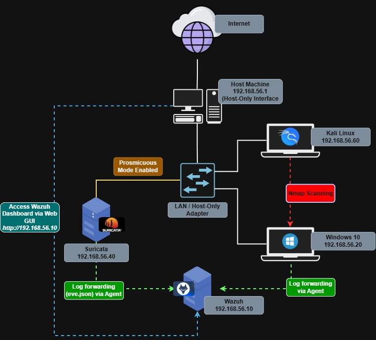

### Introduction

This repository documents my hands-on journey toward becoming a SOC analyst. I built a home lab with Wazuh (SIEM), Suricata (NIDS), and Sysmon to practice detection engineering, attack simulation mapped to MITRE ATT&CK, and incident triage

### Objectives

- Build a working SIEM + NIDS pipeline from scratch
- Generate realistic attack telemetry with Atomic Red Team and Kali
- Practice alert triage and write analyst-style incident reports
- Identify detection gaps and close them with custom rules
- Map every test to MITRE ATT&CK

### Network Architecture

| Role     | Host         | OS            | IP            | Purpose                                      |
| -------- | ------------ | ------------- | ------------- | -------------------------------------------- |
| SIEM     | `Wazuh`      | Ubuntu Server | 192.168.56.10 | Wazuh manager, indexer, dashboard            |
| NIDS     | `Suricata`   | Ubuntu Server | 192.168.56.40 | Suricata + Wazuh agent forwarding `eve.json` |
| Endpoint | `Windows 10` | Windows 10    | 192.168.56.20 | Sysmon, Atomic Red Team, Wazuh Agent         |
| Attacker | `Kali Linux` | Kali Linux    | 192.168.56.60 | Manual attacks (Nmap, Hydra, etc.)           |

### Home Lab Setup Summary

**Platform:** VirtualBox, running on a physical host PC

**Network:** 192.168.56.0/24 (Host-Only Adapter), isolated from the home LAN. Each VM also has a NAT adapter for internet access (updates, tool downloads), kept separate from lab traffic.

**Build steps:**

1. **Hypervisor** — Installed VirtualBox on the physical host.
2. **Wazuh server** — Deployed on Ubuntu Server (manager, indexer, dashboard). Attached to the Host-Only network.
3. **Suricata sensor** — Installed on a second, separate Ubuntu Server. Enabled promiscuous mode on its Host-Only adapter so it can see traffic between other VMs, and ran `suricata-update` to pull the ET Open ruleset.
4. **Windows 10 client** — Installed as the attack target. Deployed Sysmon (`OlafHartong` config) for process/network/registry telemetry, Atomic Red Team for attack simulation, then installed and registered the Wazuh agent.
5. **Kali Linux** — Set up as the attacker machine
6. **Suricata → Wazuh integration** — Installed a Wazuh agent on the Suricata host and configured it to forward `/var/log/suricata/eve.json` to the manager, using Wazuh’s built-in Suricata decoders and rules.
7. **Verification** — Confirmed end-to-end telemetry: ran a ping sweep and an Nmap SYN/service scan from Kali against the Windows 10 client, and confirmed Suricata alerts reached the Wazuh dashboard (33 alerts captured, matching the scan’s timing).

### Attack Simulation

This section documents attack simulations performed within the isolated homelab environment.

Each simulation includes:
- Attack objectives and methodology.
- MITRE ATT&CK technique mapping.
- Attack execution and commands.
- Security telemetry and evidence.
- Detection analysis and investigation.
- Detection gaps and recommended improvements.
- SOC incident report.

#### Simulation 01: Nmap Network Scanning

| Category | Details |
|---|---|
| Tool | Atomic Red Team |
| Target | Windows 10 |
| Monitoring | Sysmon, Wazuh and Suricata |
| Framework | MITRE ATT&CK |
| Status | Planned |

Objective: Evaluate network reconnaissance detection capabilities by performing host discovery and TCP SYN/service version scanning against the Windows 10 endpoint.

Key Findings:
- Discovered five active hosts within the 192.168.56.0/24 subnet.
- Identified four open TCP ports on the Windows endpoint: 135, 139, 445, and 5357.
- Suricata generated alerts for suspicious service-related scanning activities.
- ARP-based host discovery did not generate corresponding Suricata alerts.
- Individual alerts lacked scan-level correlation.

Documentation: 

